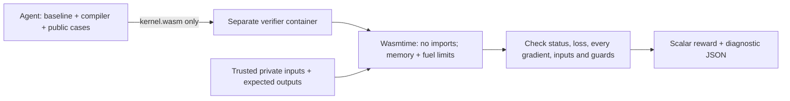

# Research Reliability Bench

A mini Harbor benchmark for **ML implementation under resource constraints**. The main task asks an agent to preserve CTC loss and complete logit gradients while replacing a dense dynamic-programming implementation to fit 1.5 MiB of WebAssembly linear memory. It measures algorithm selection, memory planning, numerical stability, and debugging of a real training primitive.

The first task, a model-selection audit, saturated: four Codex/gpt-6-luna attempts scored 1.0. Its public helper did too much of the work. We retain those trajectories and add one more substantive task rather than changing the old scores. The replacement's oracle passes and no-op fails; **model difficulty is not yet established**. See the [research and diagnosis](docs/RESEARCH.md), [design decision](docs/decisions/0002-memory-bounded-ctc.md), [observed results](results/ctc/RESULTS.md), and [assignment requirements audit](docs/OA_REQUIREMENTS.md).

## Setup and run

Requirements: Python 3.12, uv, Docker, and enough local disk to build the images. Data and test fixtures are packaged. From the repository root:

```bash
uv sync --extra dev --locked
uv run pytest -q
uv run harbor run -p tasks/ctc-memory-kernel -e docker -a oracle -k 2 -n 1 -r 0 --job-name ctc-oracle-check -o jobs
uv run harbor run -p tasks/ctc-memory-kernel -e docker -a nop -k 1 -n 1 -r 0 --job-name ctc-noop-check -o jobs
```

Oracle rewards must both be 1.0; no-op must be 0.0. Each trial uses two CPU cores and 4 GiB. Agent timeout is 20 minutes, verifier five minutes, and each image build ten minutes. This is CPU-only, within the OA's two-hour per-task budget. The reference control job completed two trials in 63 seconds on the measured Docker host; cold builds can take longer.

For four model attempts, supply your own authorized key through the environment and run:

```bash
uv run python scripts/run_trials.py --task ctc-memory-kernel --model gpt-6-luna --job-name ctc-primary-gpt-6-luna
```

This incurs model charges. It uses Harbor 0.25.0, Codex 0.163.0, medium effort, four attempts, concurrency two, and zero automatic retries. Network is restricted to `api.openai.com` during the agent phase; verifier execution has no network. Native web search is disabled. Credentials stay outside task artifacts and version control. The job wrapper adds a two-hour total deadline. Use a new job name for each independent experiment.

Daytona is supported by Harbor (`--environment daytona` plus a working `DAYTONA_API_KEY`). The OA's supplied key returned HTTP 401, so measured runs use the explicitly authorized Docker fallback. Daytona execution remains unvalidated. The assignment permits CPU-only environments and describes Daytona as optional.

## Task and success criterion

The agent receives a complete [contract](tasks/ctc-memory-kernel/environment/workspace/CONTRACT.md), correct dense C baseline, stable mathematical routines, LLVM/WASI compiler, Wasmtime runner, and public examples from every tested family. Inputs include empty targets, repeated labels, arbitrary blank labels, minimum-length and impossible alignments, extreme logits, and long sequences. It submits exactly `kernel.wasm`.

For the largest case, a dense alpha table alone needs about 12.0 MiB, before inputs and gradients. The final module has only 1.5 MiB for everything. The reference uses recursive recomputation; any implementation satisfying the published behavior and limits is accepted. No oracle storage recipe is included in the agent image. A generous deterministic fuel bound prevents unbounded recomputation; elapsed-time speedups are neither required nor claimed.

Binary reward is 1 only if **all** private cases have the correct status, loss, and full gradient. Numerical tolerances, shapes, memory, fuel, and ABI are public. Per-case results are diagnostic. A loss-only implementation or one passing small cases cannot receive complete reward.

## Verifier architecture and validity



The module receives only numeric buffers. It has no WASI, host callbacks, filesystem, network, or clock and cannot import the grader's Python or reference outputs. A fresh instance is used for each case. The verifier rejects missing/oversized modules, forbidden imports, buffer corruption, memory excess, and fuel exhaustion. The outer container bounds host and JIT resources; the linear-memory cap is not a bound on all host allocations.

Fixture generation checks an independent NumPy full-table reference against PyTorch float64 CTCLoss and autograd. Unit tests add exhaustive path enumeration and finite differences. Oracle, no-op, unchanged-baseline, and adversarial controls probe different validity claims. They do not by themselves establish model difficulty or complete attack resistance. Expected outputs and oracle source are in this private reviewer repository, never the agent build context; giving a solving agent the entire repository would invalidate that boundary.

## Reproduce and extend

`src/ctcbench/` owns the reference, fixture generator, runtime, and scorer. Rebuild fixtures and stage source into the two separate build contexts with:

```bash
uv run python scripts/prepare_ctc.py
uv run pytest -q
```

Hashes are recorded in `results/ctc/fixture-manifest.json`. The final task checksum and per-file hashes are in `results/ctc/freeze.json`. Changing task inputs, limits, runtime, or verifier requires new controls and a clearly versioned model batch. Preserve all runs, including infrastructure failures. Do not tighten the task after observing outcomes and silently report the old batch against a new version.

A larger benchmark would vary shape, numerical conditioning, and memory/work ratios across several differentiable dynamic programs. Difficulty should be calibrated using oracle-feasible budget ladders and held-out generator families, rather than seed changes alone. See the research note for alternatives, validation protocol, and scope limits.

The older [audit task](docs/V1_AUDIT.md) and its [results](results/RESULTS.md) remain reproducible. Its UCI HAR data is by Anguita et al., [DOI 10.24432/C54S4K](https://doi.org/10.24432/C54S4K), under [CC BY 4.0](https://creativecommons.org/licenses/by/4.0/); source documentation is included. CTC fixtures are synthetic. This project supplies episodic tasks and rewards, not an RL training pipeline or evidence of learning gains. The full research/redesign effort was not verified to fit the OA's five-hour timebox; recorded intervals and limitations are explicit in the results.
