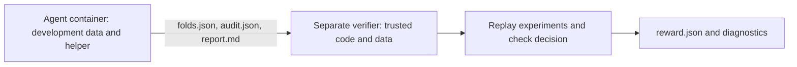

# V1 audit: historical implementation notes

A CPU-only Harbor task measuring whether an agent can turn an apparent classifier improvement into a reproducible, deployment-relevant model-selection decision. The agent audits a claim about smartphone activity recognition for unseen people. All four gpt-6-luna/Codex attempts passed. This prototype measures experimental audit execution; the observed runs did not establish frontier difficulty.

## Run the task

Prerequisites: Python 3.12, uv, and a running Docker daemon. From this directory:

```bash
uv sync --extra dev --locked
uv run pytest -q
uv run harbor run -p tasks/unseen-subject-audit -a oracle -k 2 -n 1 -r 0 --job-name oracle-check -o jobs
```

Each correct reference attempt must earn `{"reward": 1.0}` in its verifier output. Check an untouched workspace separately:

```bash
uv run harbor run -p tasks/unseen-subject-audit -a nop -n 1 -r 0 --job-name empty-check -o jobs
```

It must earn zero. The package includes prepared data; reproducing ordinary runs does not require a dataset download. See [results](../results/RESULTS.md) for observed runs, control results, and outstanding OA requirements.

For the four primary model attempts, supply `OPENAI_API_KEY` through your shell, then run:

```bash
uv run python scripts/run_trials.py --model gpt-6-luna
```

This uses Harbor 0.25.0, Codex 0.163.0, medium reasoning effort, four attempts, two concurrent Docker environments, and no automatic retries. It incurs model charges. Each attempt has a 20-minute agent timeout and five-minute verifier timeout. The wrapper adds a two-hour total job deadline. Never commit credentials. The task config permits only `api.openai.com` and disables native web search; a Docker probe confirmed that the external dataset host was blocked while the model endpoint remained reachable.

Daytona is also configured as a supported backend: install the same dev extra, set a working `DAYTONA_API_KEY`, and add `--environment daytona` to the model command. This incurs sandbox charges. The supplied assignment key returned HTTP 401, so the observed final model runs use the user-authorized Docker fallback. The brief permits CPU-only tasks and makes Daytona optional; cloud execution remains unvalidated with these credentials.

## What the agent does

The workspace supplies UCI HAR development features, labels and participant IDs, two frozen model recipes, an actual original report, and an experiment helper. The image build generates the report with the same Linux dependencies used during grading; host tree tie-breaking can differ. The original protocol randomly partitions windows. The agent reproduces it, constructs a corrected three-fold comparison for unseen people, computes equal-person accuracy and a paired-person bootstrap interval, then recommends promote, reject, or inconclusive under a published one-percentage-point policy. It submits folds, numerical evidence, and a short explanation.

The [agent contract](../tasks/unseen-subject-audit/environment/workspace/CONTRACT.md) defines all required fields, limits, metric formulas, and decision boundaries. Correct alternatives are accepted: the verifier recomputes the agent's valid folds instead of comparing with one oracle answer. Different valid partitions can support different decisions. The score therefore establishes correctness conditional on the submitted experiment, not a uniquely optimal scientific decision.

## Scoring and trust boundary

Primary reward is binary. A separate verifier container independently replays both fixed recipes on its own data, checks that corrected validation people were absent from training, reproduces the numerical evidence, and checks the decision. It transfers exactly three JSON/Markdown artifacts. It never imports agent Python, loads serialized models, or treats local agent logs or reward files as authoritative. Private official-test accuracy is diagnostic only.



Numerical verification and Docker isolation reduce common shortcuts; they do not prove resistance to every attack. Public data may be memorized. Agents choose their valid folds, so adaptive split selection remains a limitation. The interval is descriptive conditional on the CV fits. With one task and four attempts, there is no basis for a broad model ranking or a claim of RL training improvement.

## Modify and validate

`src/rrbench/` is the source of truth for metrics, folds, frozen recipes, the helper, and the verifier. `tests/` checks numerical semantics and hostile inputs. `scripts/validate_controls.py` runs real-data oracle, alternate-partition, and wrong-answer controls plus a synthetic positive-gain verifier control:

```bash
uv run python scripts/validate_controls.py
```

After changing runtime source, regenerate both build contexts with the checksummed official archive:

```bash
uv run python scripts/prepare.py /path/to/uci-har.zip
```

The URL and checksum are in [data-manifest.json](../data-manifest.json). The script preserves the official train/test separation and copies private data only into the verifier context. Rerun the unit tests, controls, and Harbor reference before interpreting new agent scores. The [ADR](decisions/0001-audit-contract.md) records the design choices. Future task families can vary the failure mechanism: temporal leakage, adaptive seed selection, evaluator contamination, and misleading throughput measurements. New mechanisms need their own oracle, controls, and model trials.

The data is UCI Human Activity Recognition Using Smartphones, by Anguita and colleagues, [DOI 10.24432/C54S4K](https://doi.org/10.24432/C54S4K), provided under [CC BY 4.0](https://creativecommons.org/licenses/by/4.0/). The original dataset README, feature documentation, and activity mappings are included in the agent context. The implementation-stage work log and limitations are in the results document; prior research preparation was not timed and is not claimed as free work under the OA's five-hour limit.
